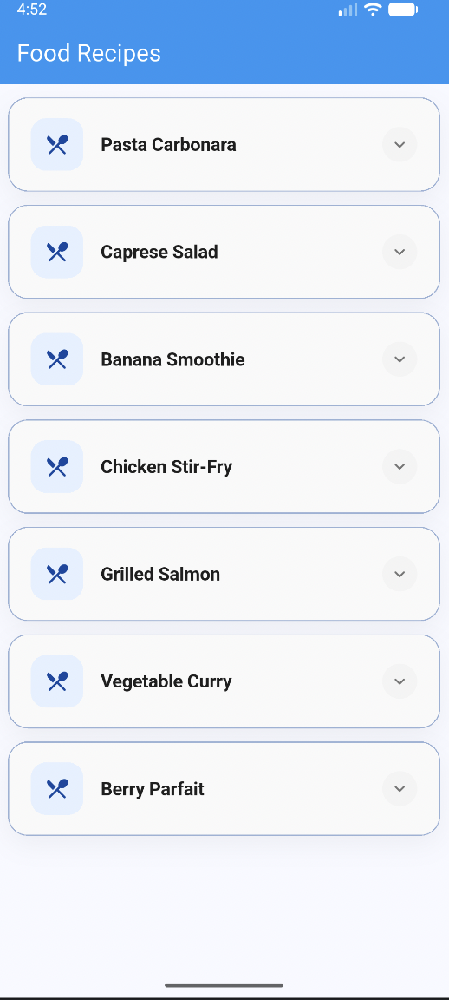

# Food Recipes App 🍽️

A simple Flutter application built to demonstrate **JSON parsing**, **data modeling**, and **dynamic UI rendering** using `ListView.builder`.

## ✨ Features
- **JSON Parsing:** Parses local JSON data containing a list of food recipes.
- **Data Modeling:** Maps JSON objects cleanly into a structured Dart `Recipe` model class.
- **Expandable Recipe Cards:** Displays recipe titles in a clean `ListView`, and tapping any card reveals its description and dynamic list of ingredients.

## 📱 Screenshots
---


## 🛠️ Tech Stack
- **Framework:** Flutter
- **Language:** Dart

## How to Run
1. Clone this repository:
   ```bash
   git clone https://github.com/mazbaul20/Assignment-b19-m11
   ```
2. Navigate to the project folder:
   ```bash
   cd Assignment-b19-m11
   ```
3. Install dependencies:
   ```bash
   flutter pub get
   ```
4. Run the app:
   ```bash
   flutter run
   ```
